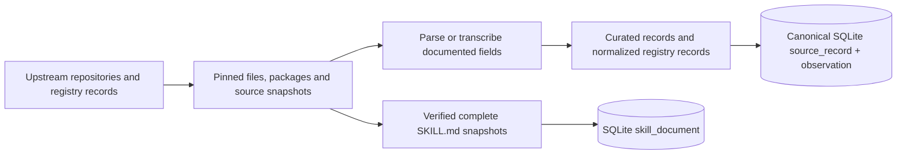
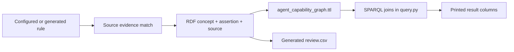

# Where capabilities come from: sources, overrides and displayed answers

This document explains the actual implementation, with the `pdf` Skill as a
worked example. It distinguishes original metadata from classification choices.
The central point is that a source description and a capability assignment are
not the same kind of information.

## 1. Four things to keep separate

| Item | Example | Origin |
| --- | --- | --- |
| Source metadata | Skill name and description in SKILL.md frontmatter | Upstream repository or imported dataset |
| Explicit classification rule | Associate `pdf` with `process / PDF document` if a passage matches | Maintained project configuration |
| Capability concept | A normalized task such as `process PDF document` | RDF construction from an action/object pair |
| Assertion | This particular Skill is associated with that task, with evidence and status | Pipeline application of a supported rule |

The source does not necessarily contain a structured `capability` field.
The project interprets source text and records a classification with its evidence.
An exact quote demonstrates where the text came from; it does not independently
prove that the interpretation is correct.

## 2. How the original rules were created

The initial mappings were exploratory classifications written with assistant
support from collected descriptions. Creating a rule involved choosing an action,
normalizing an object and selecting a phrase intended to support the association.
These were explicit modeling choices, not outputs learned by the current pipeline.
For example, `process` was chosen as a broad summary of documented PDF operations;
checking the phrase `PDF files` afterwards does not independently justify that
choice. The historical prompt and per-rule reasoning were not retained.

The following storage history is a separate fact: preserving tables in a new file
explains where they moved, not why their individual classifications are correct.

### Later file separation and recorded preservation

`config/capability_overrides.json` was created during the separation of maintained
rules from generated output. Its initial content preserves explicit rule tables
that were previously stored inside `config/capability_mappings.json`.
It is not downloaded from a registry, automatically discovered in SKILL.md, or
reconstructed by a model every time the pipeline runs.

A read-only comparison with `config/capability_mappings.json` in commit `026ce6a`
confirmed the following on November 26, 2026:

| Section | Current entries | Equal to the corresponding historical mapping table? |
| --- | ---: | --- |
| `skills` | 108 | Yes |
| `tools` | 38 | Yes |
| `static_tools` | 17 | Yes |

These counts are configuration entries, not counts of reviewed resources or
necessarily distinct capability concepts. Multiple resources can share a task.

The historical tables encode explicit project choices about action, object and
matching evidence. They were prepared during prototype construction, with
assistant-assisted work discussed in the project history. The exact original
ChatGPT prompt and raw responses are not preserved, so the repository does not
prove which individual rule was suggested by a model, independently authored,
or semantically checked by a person. Do not describe every rule as either a
verified human decision or a reproducible historical LLM result.

The traceable historical fact is preservation of those tables. The new
[override curation register](override_curation.md) now records their capture as
163 unreviewed legacy snapshots, with matching evidence reconstructed today.
Original author/prompt remain unknown. Future revisions require an explicit
actor, rationale and source checks; capture is not historical semantic review.

### Maintained input versus generated output

- `data/curation/override_history.jsonl`: authoritative event history with retained evidence snapshots.
- `capability_overrides.json`: materialized rule input, reconstructed from that history; ordinary commands read and check it.
- `capability_mappings.json`: compiled output; `import`, `mappings`, `build` and
  therefore `run` regenerate it.
- Deleting the generated file is recoverable from maintained inputs and SQLite.
- With the captured history and evidence retained, `pipeline.py overrides rebuild`
  recreates a missing override file. Descriptions alone cannot recover the original
  classification choices or their missing historical rationale.

The word "manual" here means an explicit configuration choice, possibly written
with assistant support. It does not mean an annotation has passed human review.
The RDF distinguishes `curatorMapped` as a method from `reviewed` as a status.

## 3. Where the underlying metadata comes from



For Skills, the YAML frontmatter of SKILL.md supplies fields such as `name`,
`description`, license, compatibility and allowed tools when they exist. The
collector/parser separates these fields from the rest of the Markdown document.
Secondary dataset imports have their own provenance and completeness limits.

For MCP servers/tools, data comes from registry records, selected documented
README entries, and static tool registration declarations in source code. The
initial curated manifest contains selected documented tools; it is not an
exhaustive runtime `tools/list` response from every server.

The source imports are grouped under `data/imports/`; original package evidence
is under `data/raw/downloads/`. `database.synchronize()` reconciles identities,
preserves source payloads in `source_record`, stores field observations in
`observation`, and imports available full documents into `skill_document`.

`stored_descriptions()` in `src/acg/capabilities.py` reads these SQLite records:

- curated records: description field values paired with their own field source;
- registry records: description paired with that record's source URL.

It does not search the Web or consult a model when reading these descriptions.
Source locations, revision and hashes identify the evidence; they do not establish
that a Skill is safe, useful or correctly classified.

## 4. Read one explicit rule

Actual rule from the `skills` section:

```json
{
  "pdf": {
    "action": "process",
    "object": "PDF document",
    "evidence_pattern": "PDF\\ files"
  }
}
```

Interpretation:

1. Look up the rule for the Skill key `pdf`.
2. Search its description evidence for the regular expression `PDF\ files`.
3. If the match succeeds, propose the task whose action/object are already
   specified as `process` and `PDF document`.
4. Keep the matching source and text, then mark the association as a candidate
   unless an applicable explicit reviewed decision says otherwise.

The actual source description contains the phrase "anything with PDF files".
Its source is the pinned `skills/pdf/SKILL.md` file in `anthropics/skills`, revision
`2c5958ecac7cee2b583967a2c4981d0f4a75c579`.

**The string `process` is not extracted from that phrase. It was chosen in the
rule.** The regex is an evidence guard, not a semantic parser that understands
all PDF operations. `re.escape()`-style backslashes quote literal characters;
they are regular-expression syntax, not an AI mechanism.

Matching "PDF files" alone is weak evidence for an unrestricted processing claim.
Source scope, exclusions and the appropriateness of the action still need review.

### Different override sections

| Section | How it is matched | Important limitation |
| --- | --- | --- |
| `skills` | Skill name | Equal names in different repositories may share the rule; not an identity-specific decision |
| `tools` | Curated tool record ID, often including the server prefix | Description match remains necessary |
| `static_tools` | Tool name and expected `source_name` in the normalizer | Uses static registration evidence; does not run the tool |
| `entities` | Full canonical entity URI | Replaces generated task proposals for that exact entity |

For persistent decisions about a particular resource, canonical entity overrides
are more precise than a shared name. Source URL and origin restrictions can
further constrain a rule. Without those restrictions, a matching description
from the entity's collected sources can support the rule.

`entities` can retain `reviewed` or `rejected` task rules. An empty list suppresses
new automatic/name-based proposals for that entity, but does not retract all
independent imported/static or LLM assertions. This is not a universal review
control for every kind of assertion.

## 5. The static-tool mechanism is slightly different

`src/acg/ingestion/registry/processing/resolve.py` reads the `static_tools` table.
For an accepted tool registration it checks:

```text
Known tool name?
    AND expected source_name matches?
        -> use the configured action/object
        -> preserve the registered description as evidence
        -> candidate_for_human_review
```

This path does not use `evidence_pattern` in the same way as the Skill example.
The classification remains configured, while source registration establishes
which tool was observed. Normalization exports those annotations; import stores
them in SQLite `tool_annotation`; the RDF registry mapper materializes them.
A wrong static mapping would require correcting the rule and regenerating its
normalization/import outputs, not merely changing the display query.

## 6. Automatic proposals and compiled mappings

`generate_mappings()` has these inputs:

```text
SQLite descriptions and full documents
    + capability_vocabulary.json patterns
    + capability_overrides.json maintained rules
        -> capability_mappings.json
```

For automatic extraction, each pattern already specifies a normalized action
and object. Patterns can recognize variants such as Web/internet wording and
produce the same concept. This is rule-based normalization, not free semantic
inference. Explicit negative clauses and excluded body examples are filtered
conservatively, but the filters are not a complete language understanding system.

Automatic body matches retain the quote, source, revision, document hash and
character offsets. Body format mentions and dependency/setup statements are
compiled separately as fact candidates, not automatically treated as verified
capabilities or mandatory dependencies.

During `enrich_capabilities()`:

1. Gather the selected entity's evidence texts with their own sources.
2. Find any manual name/record-ID task rule and generated canonical proposals.
3. Use canonical `entities` overrides in place of those proposals when present.
4. Ignore rejected rules; require a matching evidence pattern.
5. Enforce source restrictions if the rule specifies them.
6. For body rules, verify the current snapshot hash and exact text slice.
7. Skip duplicate entity/task assertions already recorded by the current build.
8. Add the supported task assertion; derive server tasks from exposed tools later.

The default manual task rule and automatic proposals may coexist when there is
no canonical override. That is why one Skill can have multiple capabilities.

## 7. From a rule to RDF

`add_candidate()` constructs a concept IRI from the normalized action/object,
then an assertion IRI from entity, capability, source and rule identity.
The simplified structure below uses readable illustrative identifiers:

```turtle
@prefix acg: <urn:acg:ontology:> .
@prefix ex: <urn:example:> .
@prefix skos: <http://www.w3.org/2004/02/skos/core#> .

ex:pdf acg:hasCapabilityAssertion ex:claim .

ex:processPDF a acg:Capability ;
    skos:prefLabel "process PDF document" ;
    acg:capabilityAction "process" ;
    acg:capabilityObject "PDF document" .

ex:claim a acg:CapabilityAssertion ;
    acg:assertedCapability ex:processPDF ;
    acg:assertionMethod acg:curatorMapped ;
    acg:evidenceText "PDF files" ;
    acg:basedOnSource ex:pinnedSkillSource ;
    acg:reviewStatus "candidate_for_human_review" .
```

The concept describes the task. The assertion is the traceable association
between that task and this resource. Other resources can reference the same
concept while keeping their own assertions and evidence.

`curatorMapped` identifies the explicit-rule path. Generated rules with a
`generator` field use `inferred`. Neither value alone means human approval.
An applicable rule explicitly marked `reviewed` still needs matching evidence.

The RDF builder writes these triples into the final selected Turtle graph.
Server assertions additionally link to supporting tool assertions with
`acg:derivedFromAssertion`; they are not execution guarantees.

## 8. How information appears in the terminal and CSV reports



Run:

```bash
.venv/bin/python pipeline.py query entity_capabilities.rq --name pdf
```

The query engine is RDFLib. `query.py` loads the existing Turtle file, reads the
`.rq` query, replaces the name parameter with an RDF literal, executes SPARQL,
then prints returned bindings. **It does not extract new capabilities at display
time and does not call ChatGPT.**

`entity_capabilities.rq` follows these links:

```text
entity --name--> requested name
entity --hasCapabilityAssertion--> claim
claim --assertedCapability--> concept --prefLabel--> capabilityLabel
claim --assertionMethod--> method
claim --reviewStatus--> reviewStatus
claim --evidenceType--> evidenceType
claim --basedOnSource--> source --url--> evidence
```

| Display column | RDF origin |
| --- | --- |
| `entityName` | Entity `schema:name`, originally collected metadata |
| `capabilityLabel` | Capability `skos:prefLabel`, constructed from the rule's action/object |
| `method` | Assertion method set by the attribution code path |
| `reviewStatus` | Candidate default or explicit supported review decision |
| `evidenceType` | Classification path recorded by the builder |
| `evidence` | URL of the source linked to the assertion |

The November 26 execution for `pdf` returned five task labels:

- `process PDF document`: explicit rule, method `curatorMapped`;
- `create PDF document`, `extract PDF content`, `merge PDF document`,
  `split PDF document`: generated rules, method `inferred`.

All five remained candidates. The `evidenceType` string can contain the word
"mapping" or "curated" even for an inferred rule: it describes the evidence
path, not necessarily the author or review status. Read the method and status
columns separately.

`write_review_queue()` traverses the in-memory RDF to write `review.csv`.
Editing that generated CSV does not change an override or the existing RDF.
After recording a rule decision through `pipeline.py overrides`, rebuild before
expecting query answers to change:

```bash
.venv/bin/python pipeline.py build
.venv/bin/python pipeline.py inventory
.venv/bin/python pipeline.py validate
```

`mappings` alone changes the intermediate artifact, not the Turtle being queried.
Rules under `static_tools` additionally require regeneration of their normalized
annotations as described above.

## 9. Where the new LLM mechanism fits

`ontology/capabilities_v1.ttl` defines a separate proposed closed list of 20
coarse SKOS concepts. `prompts/capability_extraction_v1.txt` asks the model to select
only those IDs, justify them with exact quotes, or abstain. New suggestions are
held separately for manual review; they never extend the list automatically.

The versioned prompt and adapter are implemented, and offline inputs have been
prepared. No EURECOM model has been called. Existing overrides and the current
154 detailed task concepts must not be described as outputs of that new adapter.
The historical ChatGPT experiment and the future reproducible endpoint workflow
are distinct. See [LLM extraction](llm_extraction.md) for the full boundary.

## 10. How to reproduce and inspect the explanation

| Question | Inspection point |
| --- | --- |
| What did the source actually say? | SQLite `source_record`, field `observation`, full `skill_document`, and original cache |
| Where was the explicit classification chosen? | `config/capability_overrides.json` |
| Which automatic wording patterns are recognized? | `config/capability_vocabulary.json` |
| Which combined proposals were generated? | `config/capability_mappings.json` |
| How were evidence and source checked? | `stored_descriptions`, `generate_mappings`, `enrich_capabilities`, `add_candidate` |
| What is currently queryable? | `data/processed/agent_capability_graph.ttl` |
| Why did the terminal show these columns? | `queries/entity_capabilities.rq` and `src/acg/query.py` |
| What remains a proposal? | Assertion review status, review reports, fixed-v1 grouping report |

To inspect historical table provenance without changing the repository:

```bash
git log --oneline -- config/capability_overrides.json config/capability_mappings.json
git show 026ce6a:config/capability_mappings.json
```

The complete system architecture is in [workflow.md](workflow.md). This document
focuses on where the classifications originate and how they become displayed
answers, rather than claiming a model automatically discovered every association.


## 11. Revising rules with retained decisions

See [override curation](override_curation.md) for bootstrap, proposal, evidence
refresh, record, audit and rebuild commands. Ordinary commands detect unrecorded
edits to the materialized file when history exists. A prepared `pdf` proposal is
available with actor/rationale intentionally empty; no semantic decision has
been invented or applied to it.
