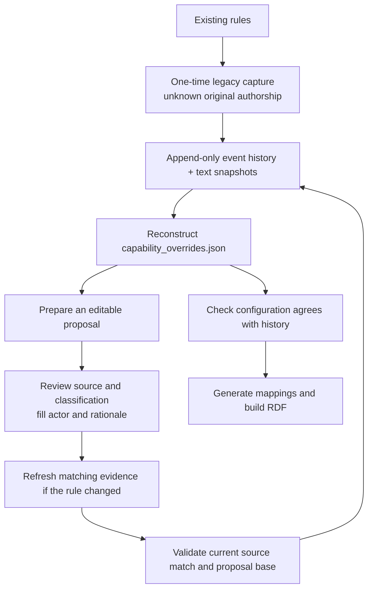

# Traceable override revision and reconstruction

Implemented on November 26, 2026. This mechanism preserves explicit classification
choices without pretending that historical choices were fully documented.

## 1. Original rule creation and the historical gap

The first mappings were exploratory action/object choices prepared from collected
descriptions with assistant support. A rule author selected the action, normalized
object and evidence phrase. The runtime then checked the phrase before emitting
an assertion. It did not learn or independently justify that classification.

The old tables were later preserved in `capability_overrides.json`. That file move
explains storage history, not the original semantic choice. The original prompt,
raw model answers, per-rule author and rationale are not available. They cannot
be recreated as if they were contemporaneous records.

The new register starts with 163 `legacy_snapshot_not_reviewed` events: 108 Skill,
38 tool and 17 static-tool rules. Their evidence was reconstructed from current
canonical descriptions during capture. All 163 have a textual match; none of
those matches establishes semantic approval. `original_author` and
`original_prompt` remain null; `actor=legacy_importer` names the recording process,
not the historical author. `recorded_at` dates this capture, not the original
creation of the rule.

## 2. Authoritative artifacts

| Artifact | Role |
| --- | --- |
| `data/curation/override_history.jsonl` | Append-only rule events; authoritative reconstruction input |
| `data/curation/evidence/<sha256>.txt` | Exact text snapshots referenced by events |
| `data/curation/proposals/*.json` | Editable proposals; not active rules |
| `config/capability_overrides.json` | Materialized rule configuration rebuilt from the history |
| `reports/curation/override_audit.json` | Chain, evidence-integrity and output-consistency summary |
| `config/capability_mappings.json` | Compiled extraction artifact with override provenance and decision-event references |
| `reports/corpus/summary.json` | Build output hash and override-history/configuration fingerprints |

Both the history and evidence snapshots must be kept and versioned. Keeping only
the materialized override file would lose the new decision history. Keeping only
hashes without their referenced text would lose reproducibility of the evidence.

## 3. Workflow



### A. Capture existing rules once

```bash
.venv/bin/python pipeline.py overrides bootstrap
```

Already executed for the current repository. Running it again does not replace
the history. This is a recording operation, not a claim that rules were reviewed.

### B. Audit the register

```bash
.venv/bin/python pipeline.py overrides audit
```

The audit verifies the event hash chain, existence and hash of evidence snapshots,
exact stored quote positions, and equality of the materialized configuration to
the event replay. It reports legacy entries and entries without captured evidence.
It does not establish that the chosen task follows logically from the quote.

### C. Prepare a revision

```bash
.venv/bin/python pipeline.py overrides propose --section skills --key pdf
```

The command prints the proposal path. A proposal for `pdf` is already prepared;
it is not overwritten if you rerun the command. Open that file in
`data/curation/proposals/`. It contains:

- current rule and fingerprint of the base rule;
- matching entity, source URL, revision and source-text hash;
- quote and exact character offsets;
- empty `actor` and `rationale` fields;
- a decision basis and optional original-author/prompt metadata.

A new key can also be proposed, but recording requires matching registered source
evidence. Unknown historical author/prompt fields should remain null unless real
supporting records are available.

### D. Review the actual classification

The reviewer should ask why the action and object are justified, whether the
quote is strong enough, whether conditions/exclusions change the interpretation,
and whether the rule is scoped to the correct resource.

For example, matching only `PDF files` is weak evidence for general processing.
A narrower operation can instead use a passage such as `merging multiple PDFs`.
Changing the rule is an explicit modeling decision, not something the audit
should approve merely because the new phrase exists.

Fill the actual actor identifier and rationale. Supported decision bases are
`source_based_revision`, `human_review` and `documented_correction`. The basis
records the kind of event; RDF status becomes `reviewed` only when the rule
explicitly includes that status and its evidence still matches. A reviewer name
is a declared identifier, not an authenticated signature.

If action/object or evidence pattern changes, refresh the candidate evidence:

```bash
.venv/bin/python pipeline.py overrides refresh --proposal PATH_TO_PROPOSAL.json
```

This refresh does not apply the rule or approve it. Inspect the updated evidence.
The currently implemented recorder supports description-backed rule decisions.
Nonempty canonical entity-rule lists and full-body-only decisions need a richer
per-rule evidence workflow; they are rejected rather than silently accepted.
Empty entity lists can explicitly suppress the corresponding generated proposals.

### E. Record the decision

```bash
.venv/bin/python pipeline.py overrides record --proposal PATH_TO_PROPOSAL.json
```

The command requires actor/rationale, checks the proposal's base against the
current rule, validates rule structure and matches it against current source
metadata again. It rejects missing or changed evidence. It appends an event,
replays the history, atomically writes the override file and audits consistency.
Each event retains the full rule, decision metadata, evidence, timestamp,
previous-event hash and its own hash. Events can set or delete a rule. A delete
requires an explicit rationale and does not claim new positive evidence.

For a manual/assistant-assisted future decision, keep the actual proposal process
and any prompt/raw response artifacts as well. Do not fill historical fields by
guessing. The separate LLM extraction workflow already saves its own versioned
requests and responses; adopting one of those results as an override is still an
explicit curation decision, not automatic vocabulary expansion.

### F. Reconstruct the override output

```bash
.venv/bin/python pipeline.py overrides rebuild
```

If the file is missing, it is recreated from the event history. If it already
agrees, replay reconstructs the same rule content. If unrecorded edits are found,
rebuild refuses to overwrite them. Inspect/save those edits first. The explicit
`--replace` flag restores recorded state after that inspection; it does not add
those unrecorded edits to the register.

Ordinary mapping generation and static annotation normalization also check
history/configuration agreement. Directly editing the materialized file is no
longer the supported revision workflow once history exists. If the register is missing, ordinary rule loading fails. Restore the history
and evidence from version control. `bootstrap` is for an explicit legacy migration,
not a routine way to bypass a missing or damaged history.

### G. Refresh graph outputs

```bash
.venv/bin/python pipeline.py build
.venv/bin/python pipeline.py inventory
.venv/bin/python pipeline.py validate
```

For changed `static_tools` rules, regenerate static annotations through
normalization/import before building:

```bash
.venv/bin/python pipeline.py normalize
.venv/bin/python pipeline.py run
```

A rule deletion does not retract independent evidence from every other mechanism.
Body-fact candidates and saved fixed-vocabulary LLM results have separate paths.
If selected normalized records changed, inspect them before explicitly refreshing
selection. Commit the history, referenced evidence, materialized config and
associated changes together for external version history.

## 4. Build trace and boundaries

Generated mappings include the history head/configuration fingerprint and, for
explicit rules, their decision event IDs. Corpus summaries record the graph hash
and override provenance. This links a particular output to the captured rule
state. An assertion's existing mappingRule key can be followed into the generated
mapping; decision IDs are not yet separate provenance nodes in the RDF itself.

Historical imported static annotations were created before this register. Their
original decisions remain unknown; changing their rules requires rerunning their
producer. The current history records configuration capture and reconstructed
evidence, not a retroactive original annotation-generation event.

Hashes detect accidental changes or disagreement with a known head. Someone who
rewrites the entire history and recomputes every hash could produce a new valid
chain; this is not a cryptographic signature or independently trusted timestamp.
Version-control history and independent review provide additional accountability.

A crash between appending a decision and replacing its materialized output can
leave a mismatch. The audit detects it; after inspection, rebuild from recorded
state repairs the derived file. This is a local file workflow, not a multi-user
transactional approval service. Concurrent writers must not record decisions
simultaneously.

The mechanism improves traceability of explicit rules from this capture forward.
It cannot recover missing historical reasoning or establish complete project-wide
provenance by itself. Prompt runs, source acquisition, ontology edits and retrieval
experiments also require their own retained artifacts and review records.
