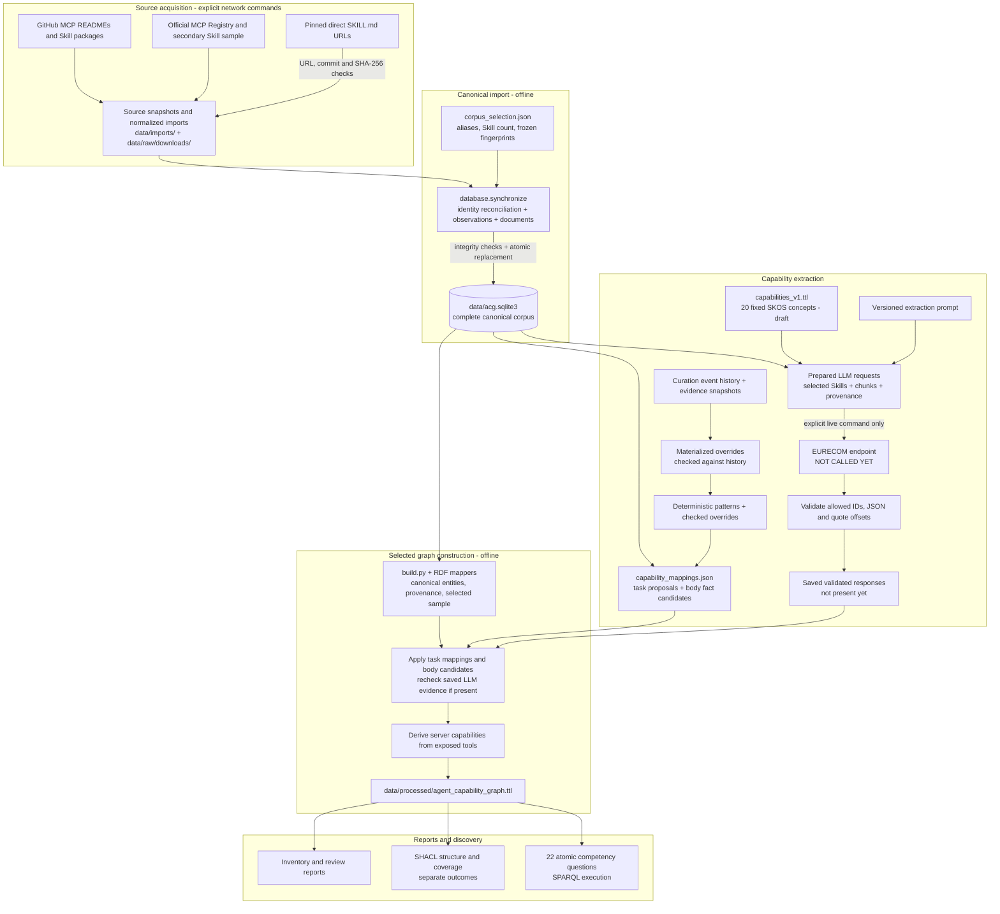
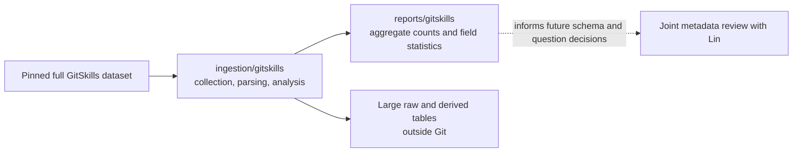
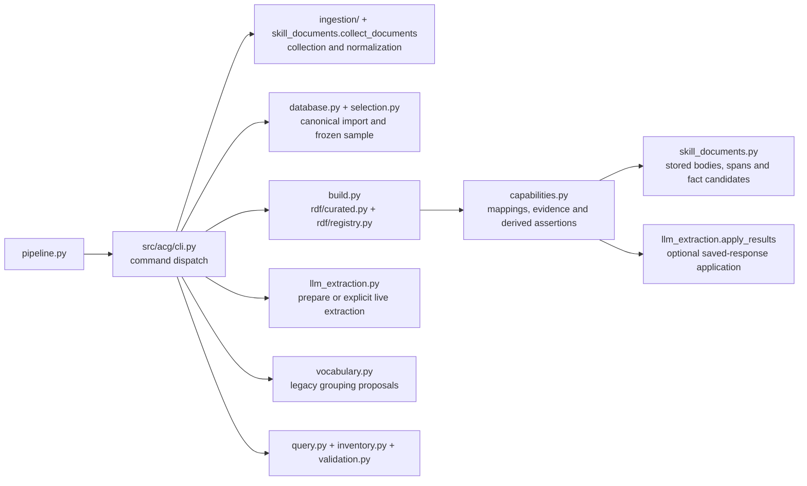
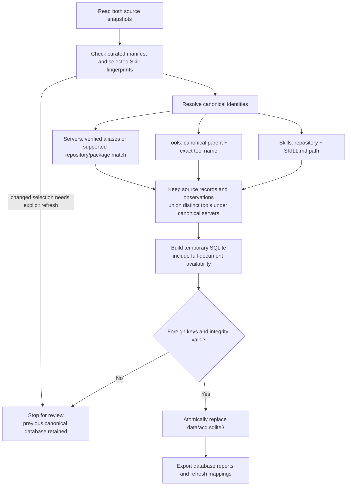
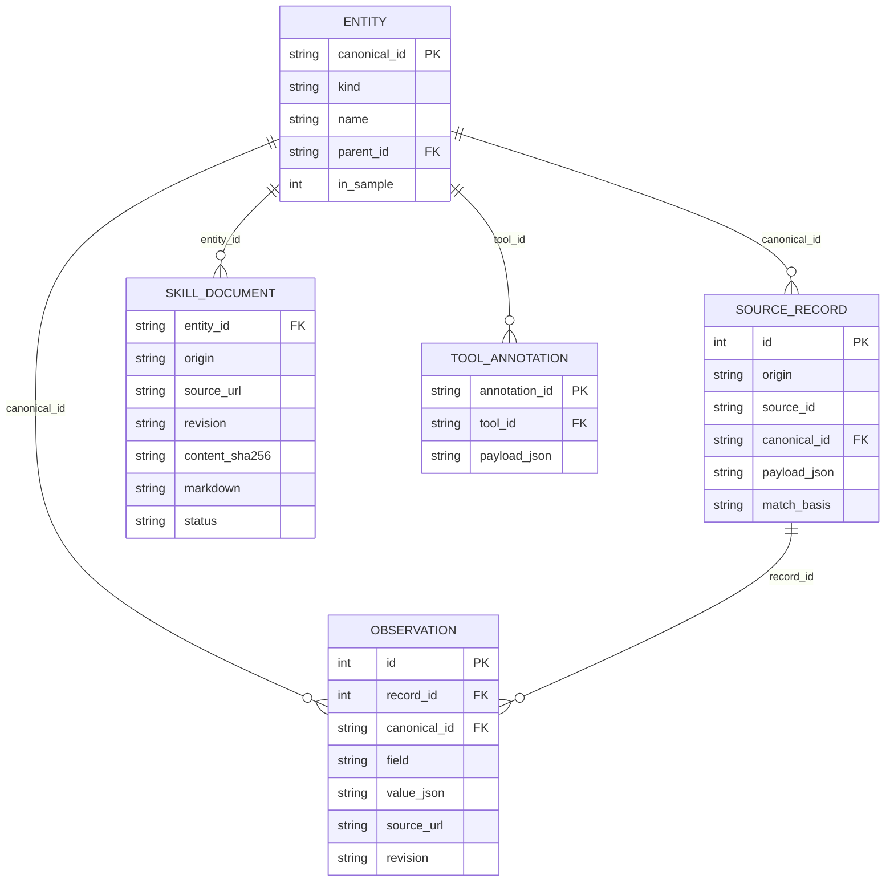
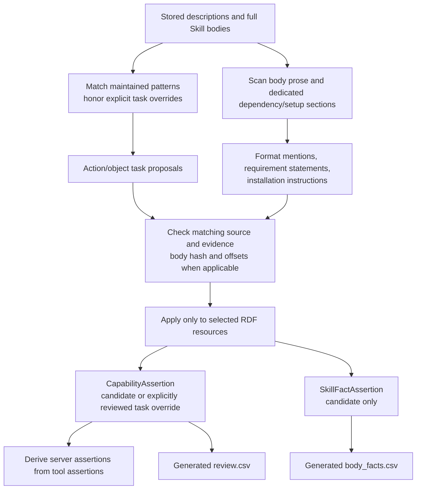
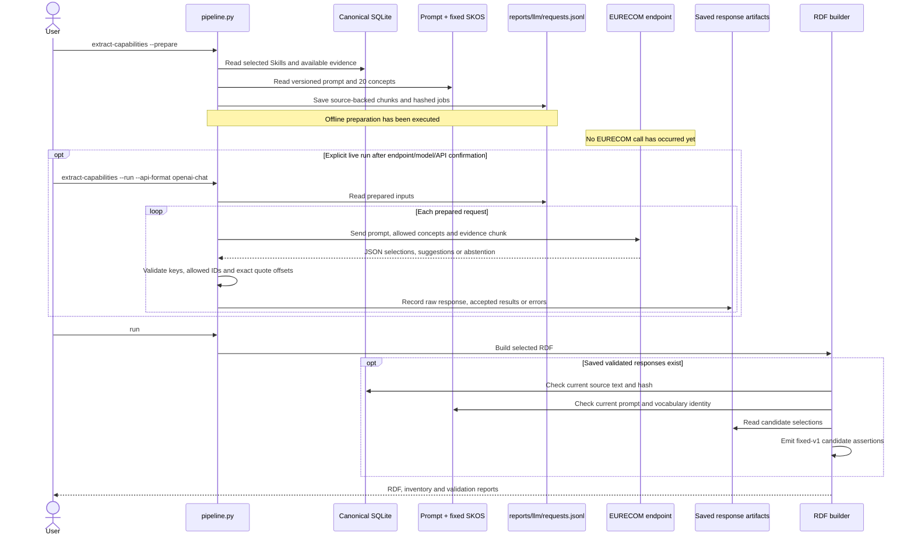
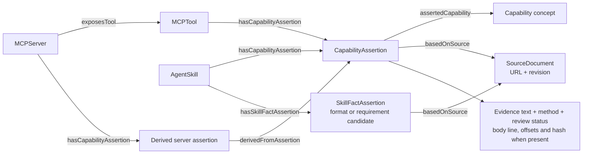

# Complete architecture and execution workflow

Architecture snapshot: November 26, 2026. This document follows the implemented
modules and recorded artifacts. It distinguishes the working offline pipeline
from the LLM adapter that has not yet been exercised against EURECOM.

## Reading guide

- Solid arrows: implemented data/control flow; they do not mean every optional
  step has already been executed.
- The LLM subgraph is implemented preparation/adapter code; its remote execution
  and resulting fixed-v1 assertions are pending.
- Public URI migration and baseline comparison are future work.
- Snapshots are source evidence; SQLite is the canonical store; Turtle is the
  selected query artifact. These are different roles, not multiple active KGs.

## 1. Overall architecture



`import` also refreshes generated mappings after replacing SQLite. `build` refreshes
them again before applying them. The diagram shows logical responsibilities,
not a requirement to invoke `mappings` manually between import and build.

### Separate full GitSkills analysis



This independent analysis is not an automatic import of millions of Skills into
SQLite or the selected RDF. The smaller accepted secondary sample is already
part of the normal registry imports.

## 2. Entry point and module responsibilities



| Responsibility | Main implementation | Important inputs | Main outputs |
| --- | --- | --- | --- |
| Initial metadata collection | `ingestion/curated.py` | Maintained source manifest, upstream files | Curated snapshot and downloaded evidence |
| Registry/Skill normalization | `ingestion/registry/` | Registry cache and Skill metadata | Accepted/quarantined normalized records and source statistics |
| Pinned body collection | `skill_documents.collect_documents` | Registered direct URLs, commit revisions, expected hashes | Verified cache files and collection statuses |
| Canonical import | `database.synchronize` | Both import snapshots, selection, body caches | SQLite, database reports, refreshed mappings |
| Skill subset selection | `selection.py` | Metadata quality, source evidence, frozen configuration | Stored selection and fingerprints |
| Existing task extraction | `capabilities.generate_mappings` | SQLite descriptions/bodies, patterns and overrides | Generated mappings and body-document reports |
| Fixed vocabulary preparation | `vocabulary.py` | Draft SKOS scheme, grouping rules, current RDF | Legacy-to-v1 proposal CSV and summary |
| Explicit-rule provenance | `override_history.py` | Event history, evidence snapshots, proposals | Audited/materialized overrides and new declared decisions |
| Description-only prompt contract | `capability_prompt.py` | Lin's separate prompt, description, HTTPS vocabulary | Rendered prompt and response validation; not the pipeline adapter |
| Lin's query audit | `ingestion/gitskills/query_audit.py` | `docs/lin_docs /lin_queries.json`, queries in `queries/lin_compentency_queries/`, RDF | Independent snapshot CSVs and hash audit in `reports/nov26/` |
| LLM extraction | `llm_extraction.py` | Selected Skill evidence, fixed vocabulary, prompt | Offline jobs or saved model responses after explicit live execution |
| RDF assembly | `build.py`, `rdf/` | Canonical selected inputs and annotation artifacts | One Turtle graph, corpus reports and review queue |
| Inventory | `inventory.py` | RDF | Candidate/reviewed/unclassified counts |
| Validation | `validation.py` | RDF and SHACL shapes | Structural and coverage reports |
| Discovery | `query.py` | RDF, SPARQL files and parameters | Answer bindings and competency execution counts |

## 3. Import and identity reconciliation



The graph sample is decided during import and stored as `entity.in_sample`, with
selection metadata in SQLite. A normal build reads this stored decision. Editing
`config/corpus_selection.json` alone does not change the already imported sample.

A shared repository does not automatically imply a shared server identity.
Repeated Skills with the same name but different package paths remain distinct.
Reimport rebuilds the canonical database from maintained snapshots; it is not an
append-only history of all previous database versions.

### SQLite relationships



This is a simplified relationship diagram, not a complete SQL declaration.
`entity.parent_id` links tools to canonical parents; several entity kinds share
the same table. Additional tables are `metadata`, `content_inventory` and
`imported_observation`. `skill_document` has a composite key, documented in code.
Views `servers`, `tools`, `skills` and `sample` simplify inspection.

## 4. Existing deterministic extraction and body facts



| Configuration | Meaning | Maintained or generated? |
| --- | --- | --- |
| `config/capability_vocabulary.json` | Fine-grained deterministic matching patterns | Maintained |
| `config/capability_overrides.json` | Explicit rules, materialized from the decision register | Reconstructed |
| `config/capability_mappings.json` | Compiled task rules and body fact candidates | Generated |

The deterministic generator scans the complete canonical corpus; the builder
emits assertions only for the selected resources. Document and fact proposal
reports can therefore cover more Skills than a query against the final RDF.

A format mention is not automatically a support assertion. Conditional dependency
statements retain their wording. Source-registration assertions are preserved
independently of newly generated proposals. Derived server assertions retain
supporting tool-assertion links and remain candidates.

### Rule provenance and reconstruction

`data/curation/override_history.jsonl` and its `evidence/` snapshots are maintained
inputs. `override_history.load_overrides()` checks the materialized configuration
against that history before rule generation; unrecorded edits cause a mismatch.
The 163 captured legacy rules are not human approvals, and their original prompt,
authorship and per-rule rationale were not recovered. Future supported revisions
require an actor, rationale and matching evidence. A hash chain checks integrity;
it does not authenticate authorship or prove semantic correctness.

`overrides propose` creates a draft, not a decision. `overrides record` records a
completed proposal, and `overrides rebuild` reconstructs configuration from the
history. Generated mappings carry decision references; this does not mean every
RDF assertion has a dedicated curation-event node. See [curation](override_curation.md)
for supported rule sections and current limitations.

## 5. Fixed SKOS vocabulary and the LLM branch

### Two vocabularies with different responsibilities

| Artifact | Current role |
| --- | --- |
| `config/capability_vocabulary.json` | Existing deterministic fine-task extraction patterns |
| `ontology/capabilities_v1.ttl` | Proposed fixed set of 20 coarse concepts for LLM selection |
| `config/capability_clusters_v1.json` | Rules proposing legacy task-to-v1 groupings |
| `reports/vocabulary/legacy_clusters.csv` | Grouping candidates and ambiguities; not accepted semantic equivalences |

The current RDF contains 154 detailed capability concepts. The draft fixed scheme
has not replaced them. These layers coexist during preparation and evaluation;
they do not imply two competing graph outputs. The historical meeting list had
149 concepts; the current grouping report covers the later 154-concept snapshot.

### LLM preparation, live execution and application



Preparation uses full documents where available and descriptions as fallback.
Documents are split into non-overlapping 8,000-character chunks, with absolute
Unicode character offsets. Each job ID hashes its full messages. The current
sample has eight prepared requests for five selected Skills.

Only the explicit OpenAI-chat adapter is implemented. Live execution requires
`ACG_LLM_ENDPOINT`, `ACG_LLM_MODEL` and optionally `ACG_LLM_API_KEY` in the local
environment. Credentials are not part of the prepared messages or saved headers.
The endpoint contract and actual model behavior have not been exercised yet.

A response selects zero to five known IDs per chunk. Unknown IDs, malformed
responses and invalid quotes are rejected. Suggestions remain in saved artifacts
for manual review and never change the scheme automatically. Quote validation
proves a text match, not the correctness of the semantic classification.

Timestamped `reports/llm/runs/` folders preserve run inputs, raw responses,
validated results and error types. `reports/llm/validated.jsonl` is the latest
accepted-response artifact read by builds. A failed run can leave explicit partial
results; inspect `errors.json` before deciding to consume those results.

The builder fails rather than silently applying results whose current prompt,
vocabulary, source hash or chunk content no longer matches. New selections are
candidate assertions, not human-reviewed decisions. They use the fixed concept
IRIs; legacy detailed assertions remain available for comparison.

### Separate description-only proposal from Lin

`src/acg/capability_prompt.py` uses
`prompts/capability_extraction_description_v1.txt`, with description-only inputs
and an `assignments` response containing concept URIs. The pipeline's
`llm_extraction.py` uses `prompts/capability_extraction_v1.txt`, document chunks,
and `selected` IDs with offsets. The contracts cannot exchange responses.
Lin's loader requires HTTPS vocabulary identifiers; the current draft scheme
uses URNs, so namespace alignment remains pending. This renderer is preserved
for joint review and is not called by `pipeline.py extract-capabilities`.

## 6. RDF assembly and provenance



The diagram illustrates supported relationships, not a claim that every tool
assertion supports every server. A server's derived claim must cite a claim on
one of its own exposed tools, for the same capability; SHACL checks this relation.

`rdf/curated.py` and `rdf/registry.py` map selected records into one in-memory graph.
Canonical identity mappings reconcile their node references and preserve source
membership/provenance. `capabilities.py` applies evidence-backed tasks and body
facts, applies optional saved LLM results, derives server claims and writes the
review queue. The builder atomically serializes the final Turtle file and writes
corpus-selection and identity reports.

`ontology/acg.ttl` defines the model. Its triples are not automatically all copied
into the data graph. The fixed SKOS graph is merged by saved-LLM application when
that artifact exists; no live extraction result exists in the recorded snapshot.

Current identifiers remain provisional URNs. The proposed w3id.org namespace is
not registered or deployed. See [URI design](uri_design.md) for the coordinated
migration, including references held in SQLite and manual decisions.

## 7. Command execution order and side effects

All commands below start with `.venv/bin/python pipeline.py` from the project root.

| Command | Reads | Writes / performs | Network? |
| --- | --- | --- | --- |
| `collect --source curated` | Manifest and upstream repositories | Curated evidence/snapshot, then canonical import and mapping refresh | Yes |
| `collect --source registry` | Registry and source repositories | Registry caches, normalization/statistics, then canonical import | Yes |
| `collect --source skill-documents` | Registered pinned URLs and hashes in SQLite | Verified body cache, collection report, then canonical import | Yes |
| `normalize` | Existing registry cache | Normalized imports/statistics, then canonical import | No |
| `import` | Source snapshots, selection, document caches | Canonical SQLite, database reports, generated mappings/document candidates | No |
| `database` | SQLite | Prints counts and refreshes database reports | No |
| `overrides audit` | Curation history, snapshots and materialized rules | Integrity/consistency audit report | No |
| `overrides propose --section skills --key pdf` | Existing rules and source evidence | Editable proposal; no approval | No |
| `mappings` | SQLite, patterns and checked overrides | Generated mappings, document/fact reports and retained review worksheet | No |
| `vocabulary` | Existing RDF, SKOS scheme, grouping rules | Legacy grouping proposals and summary | No |
| `extract-capabilities --prepare` | Selected Skill evidence, prompt and fixed scheme | Latest offline request set | No |
| `extract-capabilities --run --api-format openai-chat` | Prepared requests and endpoint environment | Explicit model calls, saved responses, errors and run artifacts | Yes |
| `build` | Selected canonical inputs, config and optional saved LLM results | RDF, corpus reports and task review queue | No |
| `inventory` | RDF | Coverage inventory and printed summary | No |
| `validate` | RDF and SHACL shapes | Separate structural and coverage reports | No |
| `run` | Same inputs as build/inventory/validate | Executes those three steps in order | No |
| `query FILE.rq ...` | RDF and query parameters | Prints SPARQL answer bindings | No |
| `competency-questions` | RDF and question formulations | Query execution/count report | No |

`build --refresh-selection` and `run --refresh-selection` first trigger a refreshed
canonical import. Neither a standalone `build` nor `mappings` refreshes SHACL
reports. The producer commands overwrite generated outputs; not every report is
updated by every command.

### What `run` does

```mermaid
sequenceDiagram
    actor User
    participant CLI as cli.main
    participant Build as build.build
    participant Cap as capabilities.py
    participant DB as SQLite
    participant RDF as Final Turtle
    participant Inv as inventory.py
    participant Val as validation.py

    User->>CLI: pipeline.py run
    CLI->>Build: Build
    Build->>DB: Load frozen selected inputs
    Build->>Cap: Refresh mappings and enrich in-memory graph
    Cap->>DB: Read descriptions and imported full bodies
    Note over Cap: Saved LLM responses are optional; no endpoint call here
    Cap-->>Build: Evidence-backed candidate graph + review reports
    Build->>RDF: Atomic serialization
    CLI->>Inv: Inventory current RDF
    CLI->>Val: Validate structure and annotation coverage
    Val-->>User: Separate outcomes and exit status
```

## 8. Validation, human review and competency questions

| Check | What it establishes | What it does not establish |
| --- | --- | --- |
| Import foreign keys / SQLite integrity | Structurally consistent canonical storage | Semantic truth of imported text |
| Pinned body hash | Download agrees with the expected recorded bytes | Safety, functionality or quality of the Skill |
| Quote and source checks | Claimed evidence matches the stored source | Correct interpretation of that evidence |
| Structural SHACL | Required graph shapes and supported relationship constraints | Exhaustive or reviewed classifications |
| Coverage SHACL | Resources with no task assertion | Absence of actual resource capabilities |
| CQ execution report | SPARQL formulations execute and return bindings | Correct retrieval or benchmark precision/recall |
| Human review | An explicit recorded decision about a specific proposal | Automatic approval of all related assertions |

Task decisions are recorded through the [curation history](override_curation.md),
which reconstructs `config/capability_overrides.json`; generated `review.csv` is
not a decision input. Those overrides do not automatically approve or
retract source-registration assertions, body fact candidates or fixed-v1 LLM
assertions. The existing body review worksheet is an evaluation aid, not an
approval input to all extractors. New LLM assertions currently remain candidates;
a complete LLM-specific human decision workflow is still future work.

[Competency questions](../queries/competency_questions.md) defines 22 proposed atomic questions.
The current report contains 25 executions because CQ02 and CQ16 are instantiated separately
for two formats and three bundle kinds. Some questions express ontology structure that the
collectors do not yet populate. In particular, MCP resource/prompt inventories
and risk signals may yield no results. Optional answer fields may remain unbound.

### Lin's independent question proposal

The root numbered queries implement the maintained 22-question atomic catalogue.
Lin's queries are preserved in `queries/lin_compentency_queries/`, with an independent
proposal in `docs/lin_docs /competency_questions.md`. Identical CQ numbers can refer
to different questions; the two proposals still require joint reconciliation.
`docs/lin_docs /lin_queries.json` supplies the paths for the standalone audit:

```bash
.venv/bin/python -m src.acg.ingestion.gitskills.query_audit
```

This regenerates `reports/nov26/` against the current graph. The committed audit
currently describes an older graph snapshot identified by its hash; it must not
be confused with `reports/queries/competency_coverage.csv`. Lin's additional
metadata-field analysis under `reports/gitskills/values-2026-11-26/` informs future
ontology/import changes; the presence of a field in the full dataset does not
mean it is already populated in the selected graph.

## 9. Current recorded snapshot

| Layer | Recorded state |
| --- | --- |
| Canonical corpus | 510 servers, 55 tools, 275 Skills |
| Complete imported Skill documents | 243 across the full store; 105 in the selected subset |
| Selected RDF | 10 servers, 55 tools, 110 Skills |
| RDF size and detailed tasks | 7,751 triples; 154 detailed capability concepts; 221 assertions |
| Task coverage | 10/10 servers, 55/55 tools, 109/110 Skills; no reviewed annotations |
| Body fact proposals | 182 across the store, not all present in the selected RDF |
| Fixed vocabulary | 20 draft SKOS concepts; detailed tasks have not been replaced |
| Legacy clustering | 113 single matches, 23 ambiguous and 18 unresolved |
| Competency formulations | 22 atomic questions, 25 executions without query errors |
| LLM | Eight offline requests for five Skills; no EURECOM execution |
| Validation | Structure passes; one unclassified placeholder Skill |

`template-skill` contains a description to be replaced. It remains unclassified
rather than receiving a fabricated task. The meeting's 149-concept / 6,765-triple
snapshot is historical and is not claimed to have been reproduced by current runs.
These numbers are recorded artifact counts, not fixed application constraints.

## 10. Operational workflows

### Rebuild and demonstrate the current offline system

```bash
.venv/bin/python pipeline.py run
.venv/bin/python pipeline.py query tools_for_web_search.rq
.venv/bin/python pipeline.py query tools_by_action.rq --action search
.venv/bin/python pipeline.py query skill_body_requirements.rq --name xlsx
.venv/bin/python pipeline.py competency-questions
```

### Add or refresh source evidence

```bash
.venv/bin/python pipeline.py collect --source skill-documents
.venv/bin/python pipeline.py run
```

Other source updates use `collect --source curated`, `collect --source registry`
or `normalize`. If imported selected records changed, inspect them before using
`import --refresh-selection`. Increase `additional_skill_count` in the selection
configuration first when intentionally enlarging the Skill subset.

### Prepare and eventually execute fixed-vocabulary extraction

```bash
.venv/bin/python pipeline.py vocabulary
.venv/bin/python pipeline.py extract-capabilities --prepare --limit 5
```

After confirming the API contract and setting endpoint/model credentials locally,
use the explicit live extraction command and then rebuild. The current endpoint
is still unconfigured. Do not interpret prepared jobs as completed extractions.

### Review and evaluate

1. Review the 22 atomic questions and fixed vocabulary with Lin.
2. Inspect ambiguous/unresolved grouping proposals.
3. Inspect evidence and label the retained small evaluation worksheet.
4. Run configured extraction, inspect model errors and abstentions, then review
   selections before treating them as accepted classifications.
5. Prepare a fixed relevance benchmark before comparing KG, keyword, tag and
   embedding retrieval in December. No comparative scores exist yet.

## Related documents

- [README and quick start](../README.md)
- [Database architecture and identity rules](architecture.md)
- [Deterministic capabilities and review](capabilities.md)
- [Fixed-vocabulary LLM details](llm_extraction.md)
- [Competency-question catalogue](../queries/competency_questions.md)
- [Validation](validation.md)
- [Supervisor demo commands](demo_commands.md)
- [Meeting deliverables and pending work](5th_Report.md)
- [Reports and their producers](../reports/README.md)
